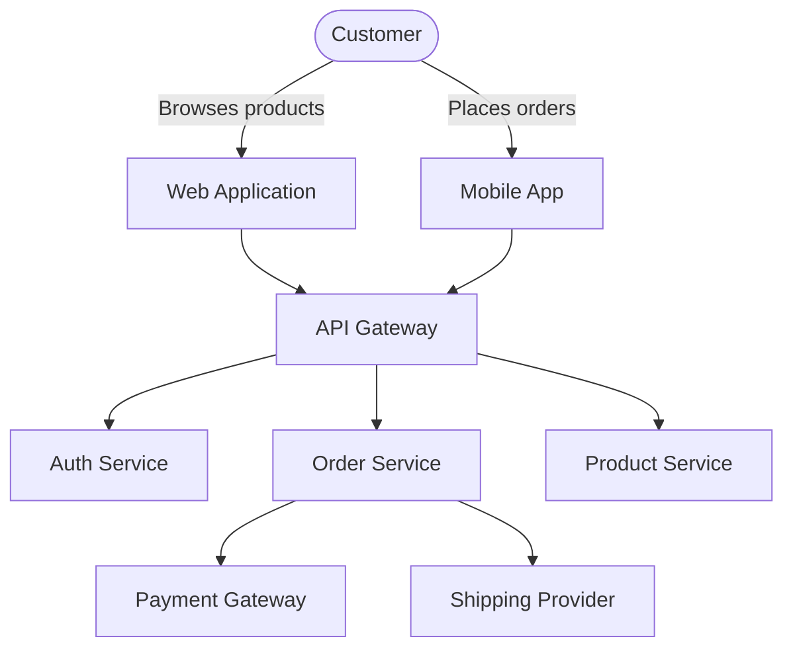
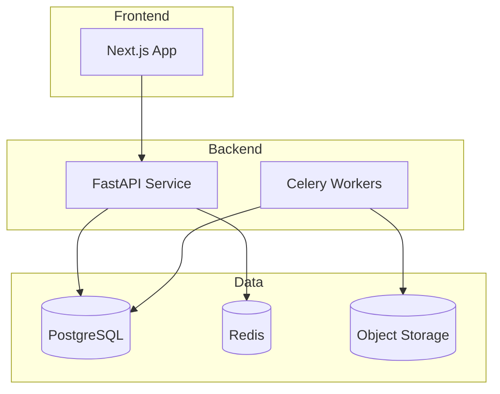

# Documentation Writer Skill

## Instructions

Technical documentation communicates how software works, how to use it, how to contribute to it, and why design decisions were made. Good documentation reduces onboarding time, prevents bugs, and makes systems maintainable. This skill covers writing API documentation, architecture documentation, user guides, code comments, and documentation best practices.

### Types of Documentation

Documentation can be categorized by audience and purpose:

| Type | Audience | Purpose | Examples |
|------|----------|---------|----------|
| Tutorials | New users | Learning by doing | Getting started guide |
| How-to Guides | Users with a goal | Solving specific problems | How to reset password |
| Reference | Experienced users | Technical description | API reference, CLI flags |
| Explanation | All audiences | Understanding concepts | Architecture overview |
| API Docs | Developers | Integration details | OpenAPI spec, JSDoc |
| README | Everyone | Project overview | Repository entry point |
| Changelog | Users/Developers | Release notes | Version changes |
| ADRs | Developers | Design decisions | Architecture Decision Records |

### The Documentation System (Diátaxis)

The Diátaxis framework organizes documentation into four quadrants along two axes:

```
                   Study (learning)
                        │
                  Tutorials  │  Explanations
                        │
Practical (task) ───────┼────── Theoretical (knowledge)
                        │
                 How-to  │  Reference
                  Guides │
                        │
                   Work (doing)
```

- **Tutorials** (learning-oriented, practical): Step-by-step lessons for beginners
- **How-to Guides** (task-oriented, practical): Solutions to specific problems
- **Reference** (knowledge-oriented, theoretical): Technical descriptions of systems
- **Explanation** (understanding-oriented, theoretical): Background and context

### Documentation Principles

- **Know your audience**: Write for the reader's level of expertise
- **Be concise**: Every word should serve a purpose
- **Be accurate**: Document what the system actually does, not what it should do
- **Be findable**: Organize content logically and provide search
- **Be maintainable**: Keep docs close to code, automate generation
- **Use examples**: Show, don't just tell
- **Include visuals**: Diagrams, screenshots, and code samples help understanding
- **Test your docs**: Have someone unfamiliar review the documentation

## Examples

### Example 1: API Documentation with OpenAPI/Swagger

```yaml
openapi: 3.1.0
info:
  title: Payment API
  version: 2.0.0
  description: |
    The Payment API allows you to process payments, manage subscriptions,
    and handle refunds. All endpoints require authentication via Bearer token.

    ## Rate Limits
    - 100 requests/minute for authenticated users
    - 10 requests/minute for unauthenticated requests

    ## Idempotency
    POST requests support idempotency keys via the `Idempotency-Key` header.
    Send the same key for retries to prevent duplicate processing.

  contact:
    name: API Support
    email: api-support@example.com
  license:
    name: MIT

servers:
  - url: https://api.example.com/v2
    description: Production
  - url: https://staging-api.example.com/v2
    description: Staging

security:
  - bearerAuth: []

paths:
  /payments:
    post:
      summary: Create a payment
      description: |
        Creates a new payment and processes it according to the specified
        payment method. For asynchronous payment methods, the endpoint returns
        immediately and the payment status is updated via webhook.

      operationId: createPayment
      tags:
        - Payments

      parameters:
        - name: Idempotency-Key
          in: header
          required: false
          schema:
            type: string
            format: uuid
          description: |
            Unique key for idempotent requests. If a request with the same
            key was already processed, the original response is returned.

      requestBody:
        required: true
        content:
          application/json:
            schema:
              $ref: '#/components/schemas/CreatePaymentRequest'
            examples:
              card_payment:
                summary: Credit card payment
                value:
                  amount: 2999
                  currency: usd
                  source: pm_card_visa
                  description: "Order #12345"
                  metadata:
                    order_id: "12345"
                    customer_vip: true

      responses:
        '201':
          description: Payment created successfully
          content:
            application/json:
              schema:
                $ref: '#/components/schemas/Payment'
        '400':
          description: Invalid request parameters
          content:
            application/json:
              schema:
                $ref: '#/components/schemas/Error'
        '401':
          description: Authentication failed
          content:
            application/json:
              schema:
                $ref: '#/components/schemas/Error'
        '409':
          description: Idempotency conflict
          content:
            application/json:
              schema:
                $ref: '#/components/schemas/Error'

  /payments/{paymentId}:
    get:
      summary: Retrieve a payment
      description: Retrieves the details of a payment by its ID.
      operationId: getPayment
      parameters:
        - name: paymentId
          in: path
          required: true
          schema:
            type: string
            pattern: '^pay_[a-zA-Z0-9]+$'
          description: The unique identifier for the payment
      responses:
        '200':
          description: Payment details
          content:
            application/json:
              schema:
                $ref: '#/components/schemas/Payment'

components:
  securitySchemes:
    bearerAuth:
      type: http
      scheme: bearer
      bearerFormat: JWT
      description: |
        JWT Bearer tokens. Obtain a token by authenticating via
        [POST /auth/login](#/Authentication/login).

  schemas:
    CreatePaymentRequest:
      type: object
      required:
        - amount
        - currency
        - source
      properties:
        amount:
          type: integer
          description: Amount in smallest currency unit (cents)
          example: 2999
          minimum: 50
          maximum: 99999999
        currency:
          type: string
          description: Three-letter ISO currency code
          example: usd
          pattern: '^[a-z]{3}$'
        source:
          type: string
          description: Payment method ID or token
          example: pm_card_visa
        description:
          type: string
          description: Human-readable description
          maxLength: 255
        metadata:
          type: object
          description: Key-value store for custom data
          additionalProperties:
            type: string
            maxLength: 500

    Payment:
      type: object
      properties:
        id:
          type: string
          example: pay_abc123
          readOnly: true
        amount:
          type: integer
          example: 2999
        currency:
          type: string
          example: usd
        status:
          type: string
          enum:
            - pending
            - succeeded
            - failed
            - refunded
            - partially_refunded
        created:
          type: integer
          description: Unix timestamp
          example: 1705315200
        failure_reason:
          type: string
          nullable: true
          description: Populated if status is failed
```

### Example 2: Getting Started Tutorial

```markdown
# Getting Started with the Payment SDK

This tutorial will walk you through integrating the Payment SDK into your
Node.js application. By the end, you'll be able to process payments and
handle webhooks.

## Prerequisites

- Node.js 18 or later
- A Payment Platform account (sign up at https://dashboard.example.com)
- Your API keys (find them in Settings > API Keys)

## Step 1: Install the SDK

```bash
npm install @example/payment-sdk
```

## Step 2: Initialize the Client

Create a file called `payment.js` and add the following:

```javascript
const PaymentClient = require('@example/payment-sdk');

const client = new PaymentClient({
  secretKey: 'sk_test_abc123def456',
  environment: 'sandbox',  // Switch to 'production' when ready
});
```

> **Security Note**: Never hardcode your secret key. Use environment
> variables: `process.env.PAYMENT_SECRET_KEY`.

## Step 3: Process Your First Payment

```javascript
async function processPayment() {
  const payment = await client.payments.create({
    amount: 4999,         // $49.99 in cents
    currency: 'usd',
    source: 'pm_card_visa',  // Test card token
    description: 'Test payment',
  });

  console.log('Payment created:', payment.id);
  console.log('Status:', payment.status);
}

processPayment().catch(console.error);
```

Run the script:

```bash
node payment.js
# Output:
# Payment created: pay_abc123
# Status: succeeded
```

## Step 4: Handle Webhooks

Create a webhook endpoint to receive payment notifications:

```javascript
const express = require('express');
const app = express();

// Use the SDK's webhook middleware
app.post('/webhooks', express.raw({ type: 'application/json' }),
  client.webhooks.middleware(),
  (req, res) => {
    const event = req.webhookEvent;

    switch (event.type) {
      case 'payment.succeeded':
        console.log('Payment succeeded:', event.data.payment.id);
        // Update order status, send email, etc.
        break;

      case 'payment.failed':
        console.error('Payment failed:', event.data.payment.id);
        // Notify customer about the failure
        break;

      default:
        console.log('Unhandled event:', event.type);
    }

    res.status(200).end();
  }
);

app.listen(3000, () => {
  console.log('Webhook server listening on port 3000');
});
```

## Step 5: Test with the Dashboard

1. Visit [https://dashboard.example.com/test](https://dashboard.example.com/test)
2. Click "Send Test Webhook"
3. Select "payment.succeeded" event
4. Observe your webhook handler receiving the event

## Next Steps

- [API Reference](/api/v2) - Full API documentation
- [Error Handling Guide](/guides/errors) - How to handle different error types
- [Production Checklist](/guides/production) - Before going live

## Troubleshooting

| Problem | Solution |
|---------|----------|
| "Invalid API Key" | Check your secret key starts with `sk_` |
| Webhook not received | Verify your endpoint is publicly accessible and returns 200 |
| Payment declined | Ensure you're using valid test card numbers in sandbox |
```

### Example 3: How-to Guide

```markdown
---
title: How to Handle Payment Refunds
description: Process full and partial refunds for payments
---

# How to Handle Payment Refunds

This guide explains how to process refunds through the Payment API.
Both full and partial refunds are supported.

## Before You Begin

- You need a payment ID in `succeeded` or `partially_refunded` status
- Refund amounts cannot exceed the remaining refundable balance
- Refunds typically take 5-10 business days to appear on customer statements

## Process a Full Refund

To refund the entire payment amount:

```javascript
const refund = await client.refunds.create({
  payment: 'pay_abc123',
});
```

This refunds the full amount of the original payment.

## Process a Partial Refund

To refund only part of the payment:

```javascript
const refund = await client.refunds.create({
  payment: 'pay_abc123',
  amount: 1000,  // $10.00 refund on a $49.99 payment
});
```

## Check Refund Status

Refunds typically transition through these states:

```
pending → processing → succeeded
                    → failed
```

Check the status with:

```javascript
const refund = await client.refunds.retrieve('ref_xyz789');
console.log(refund.status);      // "succeeded"
console.log(refund.amount);      // 1000
console.log(refund.reason);      // "requested_by_customer"
```

## Handle Failed Refunds

Refunds can fail if the original payment was already fully refunded,
the payment method is invalid, or there are insufficient funds.

```javascript
try {
  const refund = await client.refunds.create({
    payment: 'pay_abc123',
  });
} catch (error) {
  if (error.code === 'refund_amount_exceeded') {
    // The payment has already been fully refunded
    console.log('Cannot refund: payment already refunded');
  } else if (error.code === 'refund_failed') {
    // Log the failure and notify operations team
    console.error('Refund failed:', error.message);
    await notifyOperationsTeam(refund);
  } else {
    throw error;
  }
}
```

## Best Practices

1. **Always show refund status**: Display refund progress to customers in your UI
2. **Log all refunds**: Maintain an audit trail with reasons and approvers
3. **Handle idempotency**: Use Idempotency-Key to avoid duplicate refunds
4. **Partial refunds**: Explain to customers that partial refunds will be processed
5. **Time limits**: Most processors require refunds within 120 days of purchase
```

### Example 4: Code Documentation (JSDoc)

```javascript
/**
 * @fileoverview Payment processing service with retry logic and webhook handling.
 */

/**
 * Represents a payment transaction in the system.
 * @typedef {Object} Payment
 * @property {string} id - Unique payment identifier (prefixed with "pay_")
 * @property {number} amount - Amount in smallest currency unit (cents)
 * @property {string} currency - Three-letter ISO currency code
 * @property {'pending'|'succeeded'|'failed'|'refunded'} status - Current state
 * @property {number} created - Unix timestamp of creation
 */

/**
 * Creates a payment and processes it immediately.
 *
 * This function supports idempotent requests: if you pass the same
 * `idempotencyKey` for the same request body, the function returns the
 * existing payment instead of creating a new one.
 *
 * @param {Object} options - Payment creation options
 * @param {number} options.amount - Amount in cents (minimum: 50, maximum: 99999999)
 * @param {string} options.currency - ISO currency code (e.g., "usd", "eur")
 * @param {string} options.source - Payment method ID or token
 * @param {string} [options.description] - Human-readable description (max 255 chars)
 * @param {Object} [options.metadata] - Custom key-value store
 * @param {string} [options.idempotencyKey] - UUID for idempotent requests
 *
 * @returns {Promise<Payment>} The created payment object
 *
 * @throws {InvalidArgumentError} If required parameters are missing or invalid
 * @throws {AuthenticationError} If the API key is invalid
 * @throws {RateLimitError} If rate limit is exceeded
 * @throws {ApiError} For other API errors
 *
 * @example
 * // Create a simple payment
 * const payment = await createPayment({
 *   amount: 2999,
 *   currency: 'usd',
 *   source: 'pm_card_visa',
 * });
 *
 * @example
 * // Create payment with metadata
 * const payment = await createPayment({
 *   amount: 9999,
 *   currency: 'eur',
 *   source: 'pm_card_mastercard',
 *   description: 'Order #12345',
 *   metadata: { orderId: '12345' },
 * });
 */
async function createPayment(options) {
  // Implementation...
}

/**
 * Configuration options for the PaymentClient.
 *
 * @typedef {Object} ClientConfig
 * @property {string} secretKey - API secret key
 * @property {'sandbox'|'production'} [environment='sandbox'] - API environment
 * @property {number} [timeout=30000] - Request timeout in milliseconds
 * @property {number} [maxRetries=3] - Maximum retry attempts for failed requests
 * @property {Object} [headers] - Custom HTTP headers to include in requests
 */

/**
 * Main client for interacting with the Payment API.
 *
 * @class
 * @param {ClientConfig} config - Client configuration
 *
 * @example
 * const client = new PaymentClient({
 *   secretKey: process.env.PAYMENT_SECRET_KEY,
 *   environment: 'production',
 * });
 */
class PaymentClient {
    /**
     * @param {ClientConfig} config
     */
    constructor(config) {
        // ...implementation
    }

    /**
     * Process a payment asynchronously.
     *
     * For asynchronous payment methods (like bank transfers), this returns
     * immediately with status "pending". The final status is sent via webhook.
     *
     * @param {Object} options - Payment parameters
     * @param {'synchronous'|'asynchronous'} [options.mode='synchronous'] - Processing mode
     * @returns {Promise<Payment>} Payment object
     */
    async processPayment(options) { /* ... */ }
}

module.exports = { createPayment, PaymentClient };
```

### Example 5: README Template

```markdown
# Project Name

> Brief description of the project, what it does, and who it's for.

[](https://github.com/user/repo/actions)
[](https://www.npmjs.com/package/package-name)
[](LICENSE)

## Features

- ✨ Feature one - brief description
- 🚀 Feature two - performance characteristics
- 🔒 Feature three - security-related feature
- 📦 Feature four - integration capability

## Installation

```bash
npm install @example/package
# or
yarn add @example/package
```

## Quick Start

```javascript
const package = require('@example/package');

const result = package.doSomething({ option: 'value' });
console.log(result);
```

## Documentation

- [Getting Started Guide](docs/getting-started.md)
- [API Reference](docs/api.md)
- [Contributing Guide](CONTRIBUTING.md)
- [Changelog](CHANGELOG.md)

## Examples

### Basic Usage

```javascript
// Example code
```

### Advanced Usage

```javascript
// Example code with all options
```

## Configuration

| Option | Type | Default | Description |
|--------|------|---------|-------------|
| option1 | string | 'default' | Description of option |
| option2 | number | 10 | Description with constraint |

## API

### `doSomething(options)`

Description of what this function does.

**Parameters:**
- `options` (Object): Configuration object
- `options.param1` (string, required): Description
- `options.param2` (number, optional): Description (default: 10)

**Returns:** `Promise<Result>` - Description of return value.

**Example:**
```javascript
const result = await doSomething({ param1: 'value' });
```

## Contributing

Please read [CONTRIBUTING.md](CONTRIBUTING.md) for details on our code
of conduct and the process for submitting pull requests.

## Changelog

See [CHANGELOG.md](CHANGELOG.md) for release history.

## License

This project is licensed under the MIT License - see [LICENSE](LICENSE) for details.

## Support

- Documentation: https://docs.example.com
- Issues: https://github.com/user/repo/issues
- Discord: https://discord.gg/example
```

### Example 6: Architecture Documentation

```markdown
# System Architecture Overview

## Introduction

<!-- Purpose of this document and the system it describes -->

The E-Commerce Platform is a multi-tenant online store system that supports
product management, order processing, payment handling, and customer management.
This document describes the high-level architecture including components, data
flow, deployment, and key design decisions.

## System Context

<!-- System's place in the environment -->



## Container Diagram

<!-- High-level technology containers -->



## Component Diagram

<!-- Major software components and their responsibilities -->

### Order Service

Components within the Order Service:

- **OrderController**: REST API endpoints for order CRUD
- **OrderProcessor**: Business logic for order lifecycle
- **PaymentHandler**: Integration with payment gateway
- **InventoryReserver**: Manages inventory allocation
- **NotificationManager**: Sends order notifications

### Data Flow: Order Placement

```
Customer → POST /orders → OrderController → OrderProcessor
  → InventoryReserver (reserve items)
  → PaymentHandler (charge customer)
  → NotificationManager (send confirmation)
  → Response (order ID, status)
```

## Deployment Architecture

<!-- Production deployment -->

| Component | Technology | Instances | Deployment |
|-----------|------------|-----------|------------|
| Web App | Next.js | 3+ | Kubernetes (3 replicas) |
| API | FastAPI | 5+ | Kubernetes (HPA min: 3, max: 10) |
| Workers | Celery | 2+ | Kubernetes (HPA) |
| Database | PostgreSQL 16 | 1 primary + 2 read replicas | RDS Multi-AZ |
| Cache | Redis 7 | 1 cluster (3 nodes) | ElastiCache |
| Storage | S3 | N/A | AWS S3 |

## Security Architecture

<!-- Security measures and controls -->

- **Authentication**: JWT-based with refresh token rotation
- **Authorization**: RBAC with roles (admin, manager, staff, customer)
- **Data Encryption**: AES-256 at rest, TLS 1.3 in transit
- **API Security**: Rate limiting, request validation, CORS
- **Audit Logging**: All order mutations logged with before/after state

## Key Decisions

| Decision | Choice | Rationale |
|----------|--------|-----------|
| Database | PostgreSQL | ACID compliance, JSON support, team expertise |
| Queue | Redis Streams | Low latency, no additional infrastructure |
| API Style | REST | Simplicity, wide tooling support |
| Deployment | Kubernetes | Portability, scalability, ecosystem |

## Related Documents

- [API Documentation](api.md)
- [Deployment Guide](deployment.md)
- [Security Policy](security.md)
```

### Example 7: Changelog

```markdown
# Changelog

All notable changes to this project will be documented in this file.

The format is based on [Keep a Changelog](https://keepachangelog.com/en/1.0.0/),
and this project adheres to [Semantic Versioning](https://semver.org/spec/v2.0.0.html).

## [2.1.0] - 2024-06-15

### Added
- Support for partial refunds via `amount` parameter on refund creation
- New `payment.refunded` webhook event for partial refund notifications
- Rate limiting headers (`X-RateLimit-Remaining`, `X-RateLimit-Reset`)

### Changed
- Increased maximum payment amount from $10,000 to $99,999.99
- Improved error messages for declined payments (more specific decline codes)
- Upgraded minimum Node.js version to 18 (dropped 16 support)

### Fixed
- Fixed race condition in idempotency key handling for concurrent requests
- Corrected timezone handling in webhook timestamp delivery
- Resolved memory leak in long-lived WebSocket connections

## [2.0.0] - 2024-03-01

### ⚠ BREAKING CHANGES
- The `source` parameter now accepts payment method IDs (`pm_*`) instead of tokens
- Removed deprecated `POST /v1/charges` endpoint (use `POST /v1/payments`)
- Webhook payload format changed from snake_case to camelCase
- Minimum API version requirement is now TLS 1.2

### Added
- New payment method support: Apple Pay, Google Pay, and PayPal
- Webhook signature verification with `webhooks.constructEvent()`
- Idempotency support for all POST requests
- Retry logic with exponential backoff in the SDK
- Subscription management API (beta)

### Changed
- Rewrote SDK in TypeScript with full type definitions
- Improved error handling with typed error classes
- Moved from callbacks to Promises throughout the SDK

### Deprecated
- Token-based payment creation (`tok_*`) is now deprecated
- The `createCharge()` function is deprecated, use `createPayment()`

## [1.5.0] - 2024-01-10

### Added
- New API endpoint: `GET /v1/payments/:id/refunds`
- Support for custom metadata on payments (up to 20 key-value pairs)
- Dutch (nl) and Swedish (sv) localization for error messages

### Fixed
- Fixed timeout handling for bank transfer payments
- Corrected currency formatting for Japanese Yen (zero decimal)

## [1.4.2] - 2023-11-20

### Security
- Fixed XSS vulnerability in webhook dashboard display
- Updated dependencies to patch CVE-2023-44487

## [1.0.0] - 2023-06-01

### Added
- Initial release
- Payment creation with credit/debit cards
- Refund processing (full refunds only)
- Webhook delivery for payment events
- Dashboard with basic reporting
- API key management in the dashboard
```

## Best Practices

### Writing Style

- Use active voice ("The API returns..." not "The payment is returned...")
- Write clear, concise sentences (aim for 15-20 words)
- Use consistent terminology throughout documentation
- Include code examples for every API endpoint
- Show both success and error scenarios
- Use formatting (headings, lists, tables) to structure content
- Provide a table of contents for long documents

### Documentation Maintenance

- Keep documentation in version control alongside code
- Automate API documentation generation from code annotations
- Set up CI checks for broken links and formatting
- Review documentation as part of the code review process
- Update documentation before or with code changes, not after
- Remove deprecated documentation promptly
- Use analytics to track which docs are most/least viewed

### API Documentation

- Document every public endpoint with OpenAPI/Swagger
- Include request/response examples for success and error cases
- Document rate limits, authentication methods, and error codes
- Provide SDK examples in multiple programming languages
- Keep API reference up to date with automated generation

## Common Mistakes

- **Writing for yourself**: Documentation that assumes too much prior knowledge excludes newcomers. Write for the least experienced reader.
- **Not including examples**: "Show, don't tell" applies strongly to technical docs. Every endpoint, function, or concept should have a working example.
- **Outdated documentation**: Documentation that describes old versions of the system is worse than no documentation. Keep docs in sync with code.
- **No structure**: Walls of text without headings, bullet points, or code blocks are overwhelming. Use clear hierarchy and formatting.
- **Over-explaining the obvious**: "A server is a computer that serves requests" wastes reader time. Focus on what's unique or non-obvious.
- **Not testing documentation**: Documentation with broken examples, missing steps, or inaccurate descriptions frustrates users.
- **Inconsistent terminology**: Using different terms for the same concept confuses readers. Maintain a glossary.

## Libraries

### Documentation Tools

| Tool | Purpose |
|------|---------|
| JSDoc | JavaScript API documentation generator |
| Sphinx | Python documentation generator |
| MkDocs | Static site generator for project docs |
| Docusaurus | React-based documentation websites |
| OpenAPI/Swagger | REST API documentation standard |
| Stoplight | API design and documentation platform |
| ReadMe | Developer hub and API documentation |
| Mermaid | Markdown diagram generation |
| Asciidoctor | Technical documentation format |

### Writing and Style Tools

| Tool | Purpose |
|------|---------|
| Grammarly | Grammar and style checking |
| Vale | Linter for prose (integrates with CI) |
| write-good | English prose checker (npm) |
| alex | Catch insensitive language |
| textlint | Pluggable text linter |
| Markdownlint | Markdown formatting linter |

## Design Principles

### Documentation as Code

Treat documentation with the same rigor as code: version control, review process, testing, automation, and quality standards. Documentation is not an afterthought; it is a deliverable with the same importance as features.

### Minimum Viable Documentation

Start small and iterate. A single well-written README and a getting-started guide are more valuable than an encyclopedia of outdated docs. Add documentation as patterns stabilize and pain points emerge.

### Document the Why

Code and APIs tell you what the system does and how to use it. Documentation should explain why design decisions were made, what trade-offs were accepted, and what edge cases exist. This context is what makes documentation valuable over reading the code.

### Continuous Documentation

Documentation is not a phase; it is a continuous activity. Write documentation alongside code, update it during reviews, and refine it based on user feedback. Documentation quality degrades quickly without ongoing attention.

## Coding Standards

### Markdown Style

```markdown
# Title (H1)

<!-- Use ATX headings (with #) -->

## Section (H2)

### Subsection (H3)

Body text wraps at 80 characters for readability in editors.
Use blank lines between paragraphs.

**Bold** for emphasis, *italic* for mild emphasis.

`Inline code` for code references.

> Block quotes for notes, warnings, and tips.

Lists:
- Item one
- Item two
  - Nested item (indent 2 spaces)
  - Another nested item

1. Numbered item
2. Numbered item

Code blocks with language annotation:

```javascript
const x = 1;
```

Tables:
| Header 1 | Header 2 |
|----------|----------|
| Cell 1   | Cell 2   |
```

### Documentation Structure

```
docs/
  index.md              # Documentation home
  getting-started.md    # Quick start tutorial
  guides/               # How-to guides
    authentication.md
    error-handling.md
  concepts/             # Explanations
    architecture.md
    security.md
  reference/            # Reference
    api.md
    cli.md
    configuration.md
  contributing.md       # Contribution guide
  changelog.md          # Release history
```
